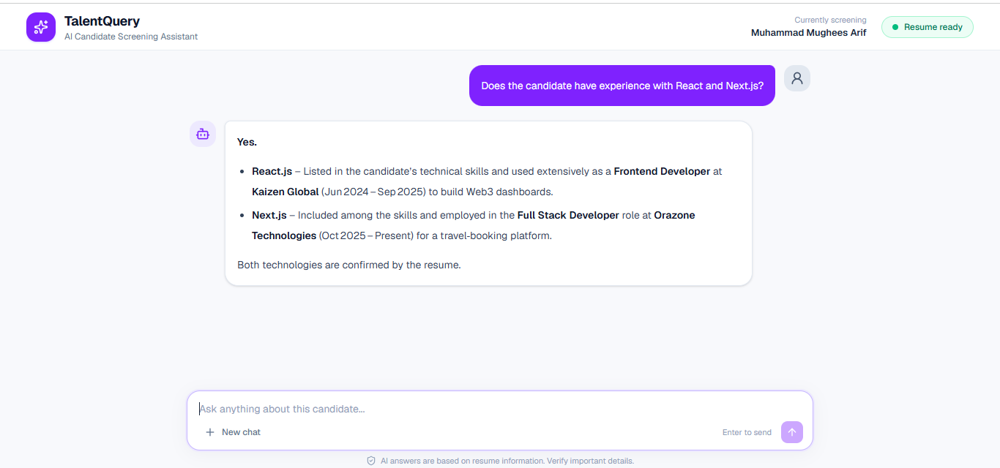
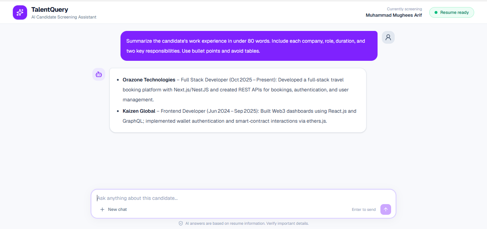
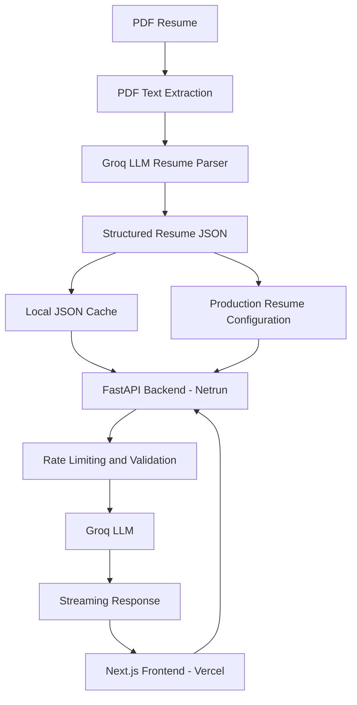

# TalentQuery — AI-Powered Candidate Screening Assistant

TalentQuery is a full-stack AI application that helps recruiters explore a candidate's qualifications through an intelligent conversational interface.

Instead of manually reviewing a resume, recruiters can ask natural-language questions about a candidate's skills, professional experience, education, and projects, and receive AI-generated answers grounded in the candidate's resume.

## Live Demo

- **Live Application:** [TalentQuery](https://talentquery.vercel.app)
- **API Documentation:** [Swagger UI](https://talentquery-api.de2.netrun.io/docs)

> The backend is hosted on a free cloud hosting plan and may take some time to respond after a period of inactivity.

## Features

- **AI-Powered Candidate Screening:** Explore candidate qualifications through natural-language questions.
- **Resume Parsing:** Extract structured candidate information from PDF resumes using an LLM.
- **Resume Caching:** Cache parsed resume data in JSON to reduce unnecessary API calls.
- **Streaming Responses:** Display AI-generated answers progressively in real time.
- **Resume-Grounded Answers:** Generate responses based on available candidate information.
- **Modern Chat Interface:** Responsive interface with suggested questions.
- **Markdown Support:** Render headings, bullet points, bold text, and tables.
- **Loading Indicators:** Provide visual feedback during response generation.
- **Error Handling and Retry:** Handle failed requests and allow users to retry.
- **Stop Generation:** Cancel an ongoing response using AbortController.
- **New Chat:** Start a fresh screening session.
- **API Rate Limiting:** Reduce excessive requests and protect API usage.
- **Request Validation:** Validate incoming questions and restrict their length.
- **Cloud Deployment:** Independently deployed frontend and backend services.

## Application Screenshots

### Welcome Screen


### AI Candidate Screening



### Professional Experience Analysis



## Tech Stack

| Frontend | Backend | AI |
|---|---|---|
| Next.js | FastAPI | Groq API |
| TypeScript | Python | GPT-OSS 120B |
| Tailwind CSS | Pydantic | LLM-based resume parsing |
| shadcn/ui | pypdf | Streaming completions |
| Lucide React | Uvicorn | Prompt engineering |
| React Markdown | SlowAPI | Resume-grounded responses |

### Deployment and Development Tools

| Tool | Purpose |
|---|---|
| Vercel | Frontend hosting |
| Netrun | Backend hosting |
| GitHub | Version control |
| uv | Python dependency management |
| Swagger UI | API documentation and testing |

## Application Architecture



## How It Works

1. The backend reads a locally configured PDF resume.
2. The pypdf library extracts text from the resume.
3. The Groq LLM converts the extracted text into structured candidate information.
4. Pydantic validates the extracted information.
5. The validated information is cached in a JSON file.
6. In production, structured resume data is loaded through environment configuration.
7. The recruiter submits a question through the Next.js chat interface.
8. FastAPI validates the request and applies rate limiting.
9. The LLM generates an answer using the candidate's resume information.
10. The response is streamed back to the frontend and displayed progressively.

## Project Structure

```text
hiremeai/
├── backend/
│   ├── main.py
│   ├── .env
│   ├── my_resume.pdf
│   └── parsed_resume.json
│
├── frontend/
│   ├── public/
│   ├── src/
│   │   ├── app/
│   │   ├── components/
│   │   │   ├── chat/
│   │   │   └── ui/
│   │   └── lib/
│   │       └── api.ts
│   ├── .env.local
│   └── package.json
│
├── screenshots/
│   ├── welcome.png
│   ├── ai-chat.png
│   └── experience.png
│
├── .gitignore
├── .python-version
├── pyproject.toml
├── uv.lock
└── README.md
```

> Environment files, resume PDFs, and generated resume JSON files are excluded from version control.

## Getting Started

### Prerequisites

- Python (version specified in pyproject.toml)
- Node.js 20.9 or later
- npm
- uv (Python package manager)
- Groq API key
- A PDF resume for local testing

Obtain a Groq API key from the [Groq Console](https://console.groq.com/).

### Clone the Repository

```bash
git clone https://github.com/mughees7984/AI-Engineering-Journey.git
cd AI-Engineering-Journey/week2/hiremeai
```

### Backend Setup

Install the Python dependencies from the project root:

```bash
uv sync
```

Create a `.env` file inside the `backend/` directory:

```env
GROQ_API_KEY=your_groq_api_key_here
ENVIRONMENT=development
FRONTEND_URL=http://localhost:3000
```

Place a test resume at:

```text
backend/my_resume.pdf
```

Start the FastAPI development server from the project root:

```bash
uv run uvicorn main:app --app-dir backend --reload
```

The backend will be available at:

- API: http://127.0.0.1:8000
- Swagger Documentation: http://127.0.0.1:8000/docs

### Frontend Setup

Open another terminal from the TalentQuery project directory:

```bash
cd frontend
npm install
```

Create a `.env.local` file inside the frontend directory:

```env
NEXT_PUBLIC_API_URL=http://127.0.0.1:8000
```

Start the Next.js development server:

```bash
npm run dev
```

Open http://localhost:3000 in your browser.

## Environment Variables

### Backend

| Variable | Description |
|---|---|
| GROQ_API_KEY | API key for Groq LLM integration |
| ENVIRONMENT | Application environment |
| FRONTEND_URL | Allowed frontend origin for CORS |
| RESUME_JSON_BASE64 | Base64-encoded structured resume data for production |

### Frontend

| Variable | Description |
|---|---|
| NEXT_PUBLIC_API_URL | FastAPI backend URL |

Never commit API keys or sensitive environment variables to GitHub.

## API Endpoints

| Method | Endpoint | Description |
|---|---|---|
| GET | `/` | Retrieve candidate information and API status |
| POST | `/chat` | Generate a complete AI response |
| POST | `/chat/stream` | Stream an AI-generated response |
| POST | `/resume/refresh` | Reparse the PDF resume and update the cache (development only) |

### Example Chat Request

```json
{
  "question": "Does the candidate have React experience?"
}
```

### Example Chat Response

```json
{
  "answer": "Yes, React is listed among the candidate's technical skills."
}
```

## API Security and Rate Limiting

TalentQuery implements basic API protection using SlowAPI and Pydantic.

| Protection | Configured Limit |
|---|---|
| Candidate information endpoint | 30 requests per minute per client |
| Chat and streaming endpoints | Shared limit of 5 requests per minute per client |
| Global chat limit | 30 requests per minute |
| Application-wide limit | 100 requests per hour per client |
| Maximum question length | 1,000 characters |
| Resume refresh | Disabled in production |

Additional security measures include:

- Server-side API key management.
- Production CORS configuration.
- Request body validation.
- HTTP 429 responses when rate limits are exceeded.
- Environment-based application configuration.

Rate limits use in-memory storage and are intended for a single-instance portfolio application. They are not a substitute for authentication or distributed abuse protection.

## Example Questions

Recruiters can ask questions such as:

- What are the candidate's strongest technical skills?
- Does the candidate have experience with React and Next.js?
- Summarize the candidate's professional experience.
- What projects has the candidate worked on?
- What is the candidate's educational background?
- Does the candidate have backend development experience?
- What is the candidate's experience with AI integration?
- Is the candidate suitable for a full-stack developer position?

## Key Technical Concepts

This project demonstrates practical implementation of:

- Large Language Model (LLM) integration
- Prompt engineering
- Structured JSON generation
- PDF text extraction
- Pydantic data validation
- Resume data caching
- Streaming AI responses
- REST API development
- Frontend and backend integration
- API rate limiting
- Request validation
- Request cancellation using AbortController
- Error handling and retry mechanisms
- Responsive UI development
- Environment variable management
- Production CORS configuration
- Cloud deployment

## Deployment

TalentQuery uses independently hosted frontend and backend services.

| Service | Platform |
|---|---|
| Next.js Frontend | Vercel |
| FastAPI Backend | Netrun |
| LLM Inference | Groq |
| Source Code | GitHub |

The frontend communicates with the backend through HTTPS REST APIs. Production CORS configuration allows requests from the deployed frontend.

The backend uses environment-based resume configuration, allowing deployment without committing the original resume PDF or parsed JSON file.

## Privacy and Limitations

TalentQuery currently supports a single configured resume and is designed as a personal portfolio demonstration.

- The live demonstration uses the author's professional resume information.
- Candidate information exposed through the public API should be treated as publicly accessible.
- Resume PDFs, parsed resume files, and API keys should not be committed to Git.
- Base64 encoding is not encryption.
- Resume information is sent to the Groq API for processing.
- Only use resumes that you have permission to process.
- The current MVP does not include authentication or authorization.
- AI-generated answers may contain errors and should be verified against the original resume.
- TalentQuery supports recruiter review and does not make automated hiring or rejection decisions.
- Questions are processed independently without multi-turn LLM conversation context.
- Free hosting may introduce cold-start delays.

## Future Improvements

- Secure resume upload
- Multiple candidate support
- Authentication and authorization
- Conversation history and multi-turn context
- Candidate search and filtering
- Database-backed candidate management
- Retrieval-Augmented Generation (RAG)
- Source citations for AI-generated answers
- Distributed rate limiting
- Automated testing and CI/CD
- Application monitoring and analytics

## Project Status

**MVP Complete & Live**

The core candidate screening functionality, resume parsing, JSON caching, streaming responses, Markdown formatting, request validation, and API rate limiting have been implemented.

The frontend and backend have been successfully deployed and integrated.

## Author

**Muhammad Mughees Arif**

Full Stack Developer | AI Engineering Enthusiast

- [GitHub Profile](https://github.com/mughees7984)
- [TalentQuery Live Demo](https://talentquery.vercel.app)
