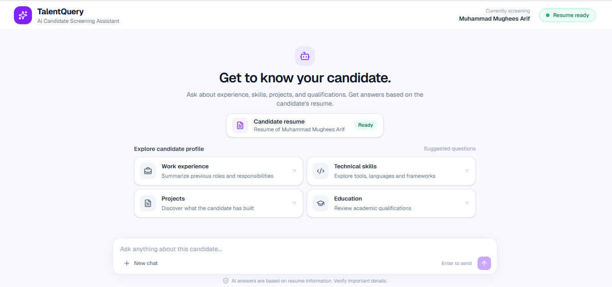
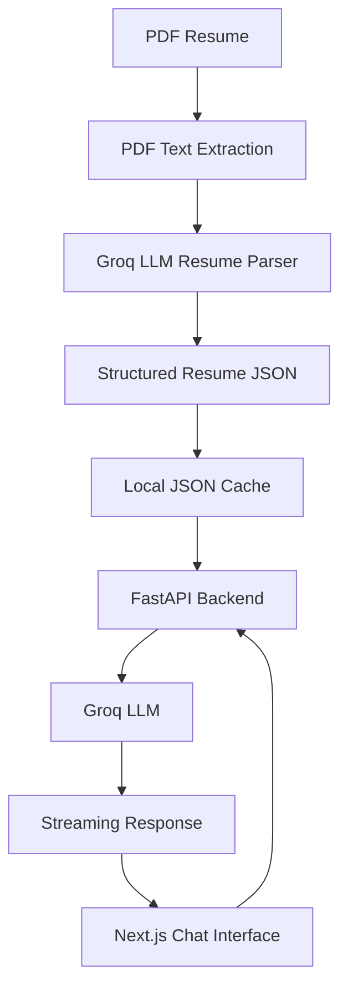

# TalentQuery — AI-Powered Candidate Screening Assistant

TalentQuery is a full-stack AI application that helps HR professionals explore a candidate's qualifications through a conversational interface.

Instead of manually searching through a resume, recruiters can ask natural-language questions and receive AI-generated answers grounded in the candidate's resume.

## Features

- **AI-Powered Candidate Screening:** Ask questions about skills, experience, education, and projects.
- **Resume Parsing:** Extract structured information from a PDF resume using a Large Language Model (LLM).
- **Resume Caching:** Store parsed resume information in JSON to avoid unnecessary API calls.
- **Streaming Responses:** Display AI-generated answers progressively in real time.
- **Resume-Grounded Answers:** Generate responses based on resume information without inventing qualifications.
- **Modern Chat Interface:** Responsive and user-friendly interface with suggested questions.
- **Markdown Formatting:** Display structured AI responses with headings, bullet points, bold text, and tables.
- **Loading Indicators:** Provide visual feedback while the AI generates responses.
- **Error Handling and Retry:** Handle failed requests and allow users to retry.
- **Stop Generation:** Allow users to stop an ongoing AI response.
- **New Chat:** Clear the current conversation and start a new screening session.

## Application Screenshots

### Welcome Screen



### AI Candidate Screening


### Professional Experience Analysis


## Tech Stack

| Frontend | Backend | AI |
|---|---|---|
| Next.js | FastAPI | Groq API |
| TypeScript | Python | GPT-OSS 120B |
| Tailwind CSS | Pydantic | LLM-based resume parsing |
| shadcn/ui | pypdf | Streaming completions |
| Lucide React | Uvicorn | Prompt engineering |
| React Markdown | JSON caching | Resume-grounded responses |

## Application Architecture



## How It Works

1. The backend reads a locally configured PDF resume.
2. The pypdf library extracts text from the resume.
3. The Groq model converts the extracted text into structured candidate information.
4. Pydantic validates the extracted information.
5. The validated information is cached in a local JSON file.
6. The recruiter asks a question through the Next.js chat interface.
7. FastAPI combines the question with the candidate's resume data.
8. The LLM generates an answer based on the available resume information.
9. The response is streamed back to the frontend and displayed progressively.

## Project Structure

```text
hiremeai/
├── backend/
│   ├── main.py
│   ├── .env                 # Local environment variables
│   ├── my_resume.pdf        # Local only; not committed
│   └── parsed_resume.json   # Generated locally; not committed
│
├── frontend/
│   ├── public/
│   ├── src/
│   │   ├── app/
│   │   ├── components/
│   │   │   ├── chat/
│   │   │   └── ui/
│   │   └── lib/
│   │       └── api.ts
│   ├── .env.local
│   └── package.json
│
├── screenshots/
│   ├── welcome.png
│   ├── ai-chat.png
│   └── experience.png
│
└── README.md
```

## Getting Started

### Prerequisites

Make sure the following tools are installed:

- Python 3.10 or later
- Node.js 20.9 or later
- npm
- uv (Python package manager)
- Groq API key
- A PDF resume for local testing

You can obtain a Groq API key from the [Groq Console](https://console.groq.com/).

### Clone the Repository

```bash
git clone https://github.com/mughees7984/AI-Engineering-Journey.git
```

Navigate to the TalentQuery project:

```bash
cd AI-Engineering-Journey/week2/hiremeai
```

### Backend Setup

Navigate to the backend directory:

```bash
cd backend
```

If the project has an existing `pyproject.toml` in the backend or a parent directory, install the declared dependencies:

```bash
uv sync
```

If the dependencies have not been declared in an initialized uv project, initialize the project if necessary and add them:

```bash
uv init
uv add fastapi uvicorn groq python-dotenv pydantic pypdf
```

Create a `.env` file inside the `backend/` directory:

```env
GROQ_API_KEY=your_groq_api_key_here
```

Place a test resume at:

```text
backend/my_resume.pdf
```

Start the FastAPI development server:

```bash
uv run python -m uvicorn main:app --reload
```

The backend will be available at:

- API: http://127.0.0.1:8000
- Swagger Documentation: http://127.0.0.1:8000/docs

### Frontend Setup

Open another terminal from the TalentQuery project directory:

```bash
cd frontend
```

Install the frontend dependencies:

```bash
npm install
```

Create a `.env.local` file inside the frontend directory:

```env
NEXT_PUBLIC_API_URL=http://127.0.0.1:8000
```

Start the Next.js development server:

```bash
npm run dev
```

Open the application in your browser:

http://localhost:3000

## API Endpoints

| Method | Endpoint | Description |
|---|---|---|
| GET | `/` | Retrieve candidate information and API status |
| POST | `/chat` | Generate a complete AI response |
| POST | `/chat/stream` | Stream an AI-generated response |
| POST | `/resume/refresh` | Reparse the PDF resume and update the JSON cache |

### Example Chat Request

```json
{
  "question": "Does the candidate have React experience?"
}
```

### Example Chat Response

```json
{
  "answer": "Yes, React is listed among the candidate's technical skills."
}
```

## Example Questions

Recruiters can ask questions such as:

- What are the candidate's strongest technical skills?
- Does the candidate have experience with React and Next.js?
- Summarize the candidate's professional experience.
- What projects has the candidate worked on?
- What is the candidate's educational background?
- Does the candidate have backend development experience?
- Is Docker mentioned in the candidate's resume?

## Key Technical Concepts

This project demonstrates practical implementation of:

- Large Language Model (LLM) integration
- Prompt engineering
- Structured JSON generation
- PDF text extraction
- Pydantic data validation
- Resume data caching
- Streaming AI responses
- REST API development
- Frontend and backend integration
- Request cancellation using AbortController
- Error handling and retry mechanisms
- Responsive UI development

## Privacy and Limitations

TalentQuery currently supports a single locally configured resume and is designed as a portfolio demonstration.

- Resume PDFs, parsed candidate data, and API keys should not be committed to Git.
- Resume text and candidate information are sent to the Groq API for processing.
- Only use resumes that you have permission to process.
- The current MVP does not include authentication or access controls.
- Public demonstrations should use fictional or anonymized candidate information.
- AI-generated answers may contain errors and should be verified against the original resume.
- TalentQuery supports recruiter review and does not make automated hiring or rejection decisions.
- The current MVP answers questions independently and does not retain previous conversation messages as LLM context.

## Future Improvements

- Secure resume upload
- Multiple candidate support
- Authentication and authorization
- Conversation history and multi-turn context
- Candidate search and filtering
- Database-backed candidate management
- Retrieval-Augmented Generation (RAG) for larger document collections
- Source citations for AI-generated answers
- Secure cloud deployment

## Project Status

**MVP Complete**

The core candidate screening functionality, resume parsing, JSON caching, streaming responses, Markdown formatting, and error handling have been implemented and tested.

## Author

**Muhammad Mughees Arif**

Full Stack Developer | AI Engineering Enthusiast

[GitHub Profile](https://github.com/mughees7984)